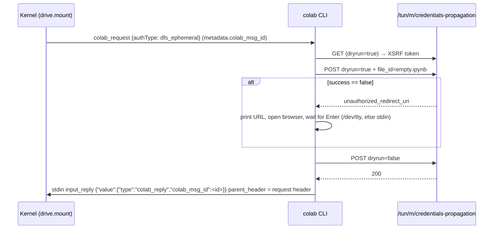

<!-- Generated from docs/02-protocol-spec.md §0. Constants, 1. Authentication, 2. Control plane, 3. Data plane, 4. SSH over WebSocket by docs-site/tools/sync-sources.py. Do not edit. -->

## 0. Constants

| Name | Value |
|---|---|
| Colab session backend ("domain") | `https://colab.research.google.com` 🟢 |
| Control-plane prefix | `/tun/m` 🟢 |
| XSSI prefix | `)]}'\n` (strip if present) 🟢 |
| Client-agent header | `X-Colab-Client-Agent: colab-cli` 🟢 (a Go build should send its **own** value; golab sends the single honest identity `github.com/20Youssef10/golab/<ver>` on every plane; see doc 08 R-03 / audit S-3) |
| XSRF header | `X-Goog-Colab-Token: <token>` 🟢 |
| Proxy-token header | `X-Colab-Runtime-Proxy-Token: <token>` 🟢 |
| Proxy-token query key | `colab-runtime-proxy-token` 🟢 |
| Accept | `Accept: application/json` 🟢 |
| `authuser` | query `authuser=0` appended to every request whose host is the Colab domain 🟢 |
| Proxy-token refresh margin | 5 minutes 🟢 |

## 1. Authentication (control plane)

Two providers, selected by `--auth`:

### 1.1 `oauth2` (default)
* Scopes requested (🟢): `openid`, `…/auth/userinfo.profile`, `…/auth/userinfo.email`, `…/auth/cloud-platform`, `…/auth/colaboratory`, `…/auth/drive.file`.
* Client: loaded from `-c PATH` (default `~/.colab-cli-oauth-config.json`), else the bundled `oauth_config.json` (`installed` client; auth URI `https://accounts.google.com/o/oauth2/auth`, token URI `https://oauth2.googleapis.com/token`). Upstream's own comment says the bundled client is Google's **cloud-SDK client** (`764086051850-…`), and the redirect below is registered *to that client*; "reusing another client id with this redirect yields `redirect_uri_mismatch`". 🟢
* **Remote copy-paste flow** (no local server, no OOB):
  1. Build the authorisation URL with `redirect_uri = https://sdk.cloud.google.com/applicationdefaultauthcode.html`, `prompt=consent`, `token_usage=remote`. 🟢
  2. Print it to **stderr**; read the pasted code from stdin (`Enter the authorization code:`). 🟢
  3. Exchange the code at the token URI. PKCE (S256) and `access_type=offline` are expected from `google-auth-oauthlib` defaults 🟡/🔴.
  4. Persist the granted scopes (clear requested scopes first to tolerate partial consent). 🟢
* Storage: OS keyring, service `google-colab-cli`, user `oauth_token`, value = authorised-user JSON. Legacy `~/.config/colab-cli/token.json` is migrated then deleted. 🟢
* On refresh failure or missing token → run the remote flow again. 🟢

### 1.2 `adc`
Application Default Credentials with the scopes above. **User credentials from `gcloud auth application-default login` ignore requested scopes**, so users must mint them with `--scopes=openid,https://www.googleapis.com/auth/cloud-platform,https://www.googleapis.com/auth/userinfo.email,https://www.googleapis.com/auth/colaboratory`. A missing `colaboratory` scope shows up as 401/403 on `/tun/m/*`. 🟢
Every control-plane request carries `Authorization: Bearer <access_token>`.

## 2. Control plane (`https://colab.research.google.com/tun/m/…`)

All JSON responses may be prefixed with the XSSI string; strip before parsing. Empty body ⇒ no payload. Non-2xx ⇒ `ColabRequestError` carrying status and body.

| # | Method & path | Params / headers | Response (inferred) |
|---|---|---|---|
| C1 | `GET /assign` | `nbh`, `variant`, `accelerator`, `shape=hm` (opt.), `authuser=0` | **either** A: `{"acc","nbh","token","variant"}` (needs XSRF POST) **or** B: `{"endpoint","runtimeProxyInfo":{…}}` (already assigned for this `nbh`) 🟢 |
| C2 | `POST /assign` | same query; header `X-Goog-Colab-Token: <A.token>` | `{"accelerator","endpoint","variant":<int>,"runtimeProxyInfo":{"token","tokenExpiresInSeconds","url"}}` 🟢 |
| C3 | `GET /assignments` | – | `{"assignments":[{"accelerator","endpoint","variant":<int>,"machineShape":<int>,"runtimeProxyInfo":{…}}]}` 🟢 |
| C4 | `GET /unassign/{endpoint}` | – | `{"token":"…"}` 🟢 |
| C5 | `POST /unassign/{endpoint}` | header `X-Goog-Colab-Token` | empty / `[]` 🟢 |
| C6 | `GET /ccu-info` | – | `{"currentBalance","consumptionRateHourly","assignmentsCount"}` 🟢 |
| C7 | `GET /credentials-propagation/{endpoint}` | `authtype=dfs_ephemeral&version=2&dryrun=true&propagate=true&record=false` | XSRF token in `.token` (parse text after first `\n`) 🟢 |
| C8 | `POST /credentials-propagation/{endpoint}` | same + `X-Goog-Colab-Token`, multipart `file_id=empty.ipynb` | `{"success":bool,"unauthorized_redirect_uri":"…"}` 🟢 |

Enums: `variant` request ∈ {`DEFAULT`,`GPU`,`TPU`}; response variant int {0 DEFAULT, 1 GPU, 2 TPU}; accelerators {`NONE`,`G4`,`T4`,`L4`,`A100`,`H100`,`V5E1`,`V6E1`}; `machineShape` {0 STANDARD, 1 HIGH_RAM}. 🟢
`shape=hm` is sent only when high-RAM is requested **and** the accelerator offers a choice (L4, V5E1, V6E1 ignore it). 🟢

### 2.1 Notebook-hash (`nbh`) encoding 🟢
`nbh = str(uuid4).replace("-", "_") + "." * (44 - len(str(uuid)))` → 36 chars + 8 dots. A fresh UUID per `new`; the **same `nbh` returns the existing assignment** (response shape B).

### 2.2 Assign algorithm 🟢
```text
resp = GET /assign
if resp is shape B: return it                       # idempotent re-attach
for attempt in 0..retries:                          # retries = COLAB_CLI_ASSIGN_RETRIES (3)
    try:  return POST /assign (XSRF = resp.token)
    except status 412: raise TooManyAssignments     # not retryable
    except ReadTimeout or status in {502,503,504}:
        if attempt == retries: raise
        sleep(backoff * 2**attempt)                 # COLAB_CLI_RETRY_BACKOFF (10s)
        resp = GET /assign                          # RECONCILE: did the POST actually land?
        if resp is shape B: return it
```
Friendly-error mapping used by `new`/`run`: **412** ⇒ "too many sessions or temporary usage/capacity limit"; **400 with an accelerator** ⇒ "no quota/entitlement for this accelerator".

### 2.3 Unassign 🟢
GET (obtain token) → POST with `X-Goog-Colab-Token`. Errors are swallowed in `run` teardown.

### 2.4 Proxy-token refresh 🟢
Before using a session: if `token_expires_at` is absent or ≤ now+5 min → `GET /assignments`, match by `endpoint`, copy `token`/`url`/expiry; endpoint absent ⇒ **prune** the local session. `expiry = now + tokenExpiresInSeconds` computed **at receipt**.

> 🔴 A third-party Rust client calls `GET /tun/m/runtime-proxy-token?…&endpoint=<ep>&port=8080` with `X-Colab-Tunnel: Google`. The official CLI does not. Capture and decide if it is useful (cheaper than listing all assignments).

## 3. Data plane: runtime proxy (`runtimeProxyInfo.url`, e.g. `https://…`)

### 3.1 How the proxy token is presented 🟡🔴
Observed in the effective call path (PyPI `jupyter-kernel-client 0.9.0` and fork `f18e982` behave identically; `extra_params` and `session` kwargs are silently ignored by both):

| Surface | Presentation |
|---|---|
| Kernel REST (`/api/kernels…`) | headers `Authorization: Bearer <ptoken>`, `X-Colab-Runtime-Proxy-Token: <ptoken>`, `X-Colab-Client-Agent`, `User-Agent: Jupyter Kernel Client`, `Accept` + `Content-Type: application/json` |
| Kernel WebSocket | URL `…/api/kernels/{id}/channels?session_id=<hex>&token=<ptoken>`; same headers; **no WS subprotocol** |
| Contents API | query `authuser=0&colab-runtime-proxy-token=<ptoken>` only |
| SSH WebSocket | query `colab-runtime-proxy-token=<ptoken>` + header `X-Colab-Ssh-Pubkey` |

The Go client should reproduce **exactly** this until capture proves a smaller sufficient set.

### 3.2 Kernel lifecycle (standard Jupyter Server REST) 🟢
| Action | Request |
|---|---|
| create | `POST /api/kernels` body `{"name":"python3","path":null}` → kernel model with `id` |
| inspect | `GET /api/kernels/{id}` (404 ⇒ kernel gone) |
| list | `GET /api/kernels` |
| restart | `POST /api/kernels/{id}/restart` |
| interrupt | `POST /api/kernels/{id}/interrupt` |
| shut down | `DELETE /api/kernels/{id}` (404 ignored) |

**Attach logic.** With a cached `kernel_id`: `GET` it; **404 ⇒ silently create a new kernel** (state is lost). Without: create. After attach, persist `kernel_id` and the client-generated `session_id` (uuid hex).
> ⚠️ Upstream persists the new kernel id only `if not self.kernel_id` (`runtime.py`). If a cached id was stale and a replacement was created, the new id is **not** saved (likely bug, verify in **S1**). Go must always persist the effective id.

Connection retry: up to 3 attempts, backoff `2^(i+1)` s (2 s, 4 s) on connect/read timeouts only. 🟢

### 3.3 Kernel WebSocket: Jupyter "default" protocol 🟢
`GET wss://…/api/kernels/{id}/channels?session_id=…&token=…`, client WS ping every **60 s**.

* **Text frame** (no buffers): one JSON object
  ```json
  {"header":{"msg_id":"…","msg_type":"execute_request","username":"…","session":"<hex>","date":"2026-11-14T09:00:00.000000Z","version":"5.3"},
   "parent_header":{}, "metadata":{}, "content":{…}, "channel":"shell", "buffers":[]}
  ```
* **Binary frame** (buffers present): `[u32be nbufs][u32be offset × nbufs][json][buf1]…` where `offset[0]` = `4*(nbufs+1)`; `nbufs < 2` is invalid. 🟢
* Channels used: `shell`, `iopub`, `stdin`, `control`, `hb` (queues per channel). No HMAC signing over WS.
* **Raise the WebSocket read limit** (Go libraries default to ~32 KiB; iopub messages carrying images are megabytes).

### 3.4 Execute 🟢
Send on `shell`:
```json
{"code":"…","silent":false,"store_history":true,"user_expressions":{},"allow_stdin":false,"stop_on_error":true}
```
Upstream does **no** `kernel_info` handshake before executing. (Go may add one for robustness; see doc 03 ADR-009.)

Loop (idle-timeout semantics 🟢):
1. Read `iopub` messages, ignoring those whose `parent_header.msg_id` ≠ our `msg_id`.
2. Any `status` with `execution_state ∈ {dead, restarting}` ⇒ error "Kernel … before the code finished" (this check runs **before** the parent filter).
3. Feed each message to the accumulator (§3.5).
4. On `status: idle` (matching parent) ⇒ read `shell` until the `execute_reply` with matching parent.
5. Every wait slice is 1 s; if `timeout` > 0 and no message arrives for `timeout` s ⇒ `TimeoutError("no message from the kernel for Ns")`. `timeout ≤ 0` ⇒ unlimited. Connection loss ⇒ `"Connection was lost."`
6. If `reply.content.status == "error"` and no error output was collected ⇒ synthesise `{output_type:"error", ename, evalue, traceback}`.

Defaults: `exec`/`run` idle timeout **30 s**; interactive automations **600 s**.

### 3.5 Output accumulator (exact semantics of `output_hook`) 🟢
| iopub `msg_type` | Effect |
|---|---|
| `execute_result` | append `{output_type, metadata, data, execution_count}` |
| `stream` | append `{output_type:"stream", name, text}` (**no merging** of adjacent streams) |
| `display_data` | append `{output_type, metadata, data, transient}` |
| `error` | append `{output_type:"error", ename, evalue, traceback}` |
| `clear_output` | clear the list (ignores `wait`) |
| `update_display_data` | find outputs with the same `transient.display_id`; replace `metadata` and `data` in place |
| others | ignored |

Streaming render hook fires once per **newly appended** index.

### 3.6 stdin 🟢
With `allow_stdin=true`: an `input_request` on `stdin` carries `content.prompt`; reply `input_reply {"value": "<text>"}` on `stdin`. **Streaming `output_hook` and `allow_stdin` are mutually exclusive** upstream (`NotImplementedError`).

### 3.7 Colab extension: `colab_request` 🟢
Arrives as an iopub-delivered message with `msg_type == "colab_request"`; intercepted **before** normal queueing. For `content.request.authType == "dfs_ephemeral"` (Drive mount):


Other `authType`s fall through to the normal path. Windows has no `/dev/tty`: use the console (`CONIN$`), else stdin.

### 3.8 Contents API 🟢
| Op | Request | Notes |
|---|---|---|
| list | `GET /api/contents/{path}` | `{type:"directory", content:[{name,type}]}` or a file model |
| read | `GET …?content=1` | `format` ∈ `base64` (decode), `json` (re-encode, indent 2), else text |
| write | `PUT /api/contents/{path}` | `{"name","path","type":"file","format":"base64","content":<b64>,"chunk":1}` |
| delete | `DELETE` | no body |
Path: strip leading/trailing `/`, percent-encode but keep `/`. 404 ⇒ not-found error. Remote paths are relative to the **VM root** (`content` = `/content`). 🔴 *Verify Jupyter chunked upload (`chunk: N`, last = `-1`) is honoured by Colab's server before streaming large files (spike **S6**).*

## 4. SSH over WebSocket 🟢

`GET wss://<proxy-host>/colab/ssh?colab-runtime-proxy-token=<ptoken>&colab-client-agent=<agent>&colab-client-agent=ssh-mode-<mode>`
Headers: `X-Colab-Ssh-Pubkey: <public key line, verbatim>`, `X-Colab-Client-Agent`.
`mode` ∈ `interactive` (plain `colab ssh`), `cmd` (`-- CMD`), `proxy` (ProxyCommand/IDE).

* Accepted key types: `ssh-ed25519`, `ecdsa-sha2-nistp256|384|521`. **RSA ⇒ HTTP 400 "unsupported key type".** 🟢
* After the upgrade, **binary WS frames carry the raw SSH byte stream** to the VM's `sshd` (user `root`, host alias `colab-runtime`). Client sends binary; text frames received are treated as bytes. Close frame ⇒ EOF. 🟢
* Remote working dir: run `cd /content 2>/dev/null; exec ${SHELL:-/bin/bash} -l` (interactive) or `cd /content 2>/dev/null; <cmd>`.
* Upgrade failures: 400 (bad/missing key), 401 (token), 403 (forbidden), **404 (SSH not enabled on this runtime; baked in at creation)**, **429** (session limit; body `{"error":"already-active-session","limit":N}` with `1 ≤ N ≤ 5`), 502 (sshd unreachable). Exact messages: doc 05 §ssh.
* Host keys are ephemeral per runtime ⇒ upstream disables host-key checking (`StrictHostKeyChecking=no`, null known-hosts). Rationale and our stance: ADR-005.
