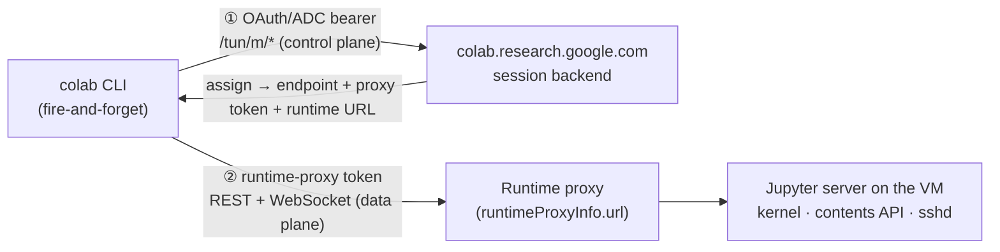

# 01 · Analysis of the Python Colab CLI

> **Subject:** `googlecolab/google-colab-cli` at tag `v0.8.0` (+2 commits), Apache-2.0.
> **Method:** full clone and read of `src/`, `docs/`, `AGENTS.md`, `CHANGELOG.md`, `cloudbuild.yaml`, `uv.lock`; plus the Colab fork of `jupyter-kernel-client` it depends on (commit `f18e982`) and PyPI release `0.9.0`.
> **Rule used throughout:** where documentation and code disagree, **code wins**. Disagreements are listed in §9.

---

## 1. What it is

A terminal front-end for Google Colab. It rents a Colab VM (CPU/GPU/TPU), attaches to its Jupyter kernel, runs code, moves files, opens SSH, and releases the VM.

| Fact | Value |
|---|---|
| Language / runtime | Python ≥ 3.12 (`requires-python`) |
| Source size | ≈ 5,700 LOC in `src/colab_cli` |
| Tests | 38 files, ≈ 360 test functions, plus 7 live integration suites in `integration/` |
| Distribution | PyPI `google-colab-cli` (built by Cloud Build → OSS Exit Gate → PyPI) |
| Versioning | derived from git tags via `hatch-vcs` |
| Platform claim | README: "supports **Linux and macOS** only. Windows is not supported at this time." Partial Windows handling nevertheless exists in the SSH path (`test_windows_ssh`, `integration/repro_windows_ssh`). A maintainer reply in Discussions says none of the team have Windows machines (paraphrased from a search snippet). |
| Churn | Very high. `colab console` was removed and `colab ssh` added between 0.7.x and 0.8.0. Treat as a **moving target** (see doc 06 §Upstream sync). |

## 2. The mental model (read this first)



* **Two planes, two credentials.** The control plane (allocate/list/release VMs, usage) authenticates with the *user's* Google OAuth/ADC bearer token. The data plane (kernel, files, SSH) authenticates with a short-lived **runtime-proxy token** returned by the control plane. Upstream's `AGENTS.md` #15 insists these are never confused. (A third, unrelated thing is `colab auth`: it injects credentials *into the VM*.)
* **Fire-and-forget.** No daemon, no background threads. Each command authenticates, does one job, exits. (A keep-alive daemon existed and was **removed on 2026-09-25**; the backend now keeps VMs alive from kernel activity. Third-party blog posts still describe the daemon, so they are stale.)
* **Kernel state persists** across `exec` calls because the kernel ID and session ID are cached in `sessions.json`; each command re-attaches to the same kernel and closes only its WebSocket.
* **Working directory** is forced to `/content` before every `exec`/`run`.

## 3. Source map: module → responsibility → Go destination

| Python module | ≈LOC | Responsibility | Go package (doc 03) |
|---|---:|---|---|
| `cli.py` | 140 | Typer root; global flags; alphabetical help; update-check gate | `internal/cli` |
| `common.py` | 254 | `State` singleton; session resolve/refresh/prune; **log redaction regex** | `internal/app`, `internal/logx` |
| `auth.py` | 383 | `oauth2` (remote copy-paste flow + keyring) and `adc` providers | `internal/auth` |
| `client.py` | 340 | Control-plane client: assign/unassign/list/ccu; XSSI; XSRF; retries | `internal/colabapi` |
| `runtime.py` | 351 | Kernel attach, execute, stream, idle-timeout, `colab_request` hook | `internal/runtime` |
| `contents.py` | 85 | Jupyter Contents API (ls/rm/upload/download) | `internal/contents` |
| `state.py` | 160 | `sessions.json`/`settings.json` stores with file locks | `internal/state` |
| `history.py` | 60 | Per-session JSONL event log | `internal/history` |
| `converter.py` | 190 | history → `.ipynb` / `.md` / `.txt` / `.jsonl` | `internal/history`, `internal/nb` |
| `repl.py` | 160 | prompt_toolkit REPL with Pygments highlighting | `internal/repl` |
| `utils.py` | 110 | status-code helpers, Kitty images, display-data rendering | `internal/render` |
| `auto_update.py` | 250 | PyPI update probe, daily throttle, `pip`/`uv` self-install | `internal/update` |
| `consumption.py` | 55 | `ccu-info` models and formatting | `internal/colabapi` |
| `commands/session.py` | 380 | `new`, `sessions`, `status`, `stop`, `restart-kernel` | `internal/cli` |
| `commands/execution.py` | 380 | `exec`, `repl`; `--env` prelude; notebook execution | `internal/cli` |
| `commands/run.py` | 520 | One-shot `new`+`exec`+`stop`; shebang support; SystemExit→exit code | `internal/cli` |
| `commands/files.py` | 135 | `ls`, `rm`, `upload`, `download`, `edit` | `internal/cli` |
| `commands/automation.py` | 215 | `auth`, `drivemount`, `install`; Drive-auth interception | `internal/cli`, `internal/runtime` |
| `commands/ssh.py` | **835** | SSH-over-WebSocket; ProxyCommand bridge; `--rm` teardown | `internal/sshx` |
| `commands/utility.py` | 400 | `pay`, `url`, `log`, `whoami`, `version`, `update`, `readme`, `skill` | `internal/cli` |
| `commands/usage.py` | 25 | `usage` (compute units) | `internal/cli` |
| `oauth_config.json` | – | Bundled OAuth client (see doc 08 R-02) | `internal/auth` (embed) |

## 4. User-facing command inventory

`new` · `sessions` · `status` · `stop` · `restart-kernel` · `exec` · `repl` · `run` · `ls` · `rm` · `upload` · `download` · `edit` · `auth` (hidden) · `drivemount` · `install` · `ssh` · `usage` · `url` · `log` · `pay` · `update` · `version` · `help`
Hidden: `whoami`, `readme`/`README`, `skill`/`SKILL`.
Removed upstream: `console` (replaced by `ssh`). **Do not port it.** The per-command parity table is in doc 05.

### Global options
| Flag | Default | Notes |
|---|---|---|
| `-c`, `--client-oauth-config` | `~/.colab-cli-oauth-config.json` | falls back to the bundled client when the file is absent |
| `--config` | `~/.config/colab-cli/sessions.json` | state isolation for parallel/agent runs |
| `--logtostderr` | off | |
| `--auth {oauth2,adc}` | **`oauth2`** (code) | `SKILL.md` wrongly says `adc` (see §9) |

### Environment variables found in the code
`COLAB_CLI_REQUEST_TIMEOUT` (seconds; **unset = no timeout**), `COLAB_CLI_ASSIGN_RETRIES` (default 3), `COLAB_CLI_RETRY_BACKOFF` (default 10 s, doubled per attempt). Remote-side only: `USE_AUTH_EPHEM=0` (set inside the VM when running `auth`).

## 5. On-disk state (compatibility surface)

Everything lives under `~/.config/colab-cli/` (**on every OS, including Windows**, in the Python tool).

| File | Content | Notes |
|---|---|---|
| `sessions.json` | `{ "<name>": SessionState }` | schema below |
| `settings.json` | `update_url`, `last_check`, `enable_update_check`, `latest_version` | `update_url` is user-editable |
| `history/<name>.jsonl` | one JSON event per line | `timestamp` (UTC ISO-8601), `event_type`, payload |
| `colab.log` | **DEBUG-level log, always on** | no rotation; secrets masked by regex |
| `*.lock` | `filelock` read/write lock files | |
| `token.json` | legacy plaintext token | migrated into keyring then deleted |
| keyring entry | service `google-colab-cli`, user `oauth_token` | value = `Credentials.to_json()` |

`SessionState` (pydantic; **unknown keys are ignored on load**, so Go may add fields safely):
```json
{ "name": "s1", "token": "<runtime-proxy-token>", "url": "https://…",
  "endpoint": "<assignment endpoint>", "token_expires_at": "2026-11-14T10:00:00Z",
  "variant": "GPU", "accelerator": "T4", "machine_shape": "STANDARD",
  "kernel_id": "…", "session_id": "…",
  "last_execution": ["stdin", null, "2026-11-14 09:58:01"], "running": null }
```
Token refresh rule: if `token_expires_at` is missing or within **5 minutes**, call `GET /tun/m/assignments`, update from the matching endpoint, and **prune** the session if its endpoint is gone.

History event types: `session_created`, `session_terminated`, `execution`, `stdin_request`, `input_reply`, `file_operation`, `automation`, `automation_result`, `colab_request`, `drive_auth_needed`, `drive_auth_success`.

## 6. Python dependency → Go equivalent

| Python | Used for | Go choice (rationale in doc 03) |
|---|---|---|
| `typer`/`click` | CLI | `spf13/cobra` + pflag |
| `requests` | HTTP | `net/http` (explicit timeouts, one shared client) |
| `pydantic` | models | structs + `encoding/json` + validation funcs |
| `google-auth`, `google-auth-oauthlib` | ADC, OAuth | `golang.org/x/oauth2`, `x/oauth2/google` |
| `keyring` | token store | `zalando/go-keyring` + file fallback |
| `jupyter-kernel-client` (Colab fork) | **kernel client** | **own implementation** (~600 LOC), no Go library exists |
| `websocket-client` | WS | `coder/websocket` (`NetConn()` is needed for SSH) |
| `prompt_toolkit`, `pygments` | REPL, highlighting | `alecthomas/chroma` + a readline lib (spike) |
| `rich`, `html2text` | rendering | `charmbracelet/glamour`, `html-to-markdown` |
| `nbformat` | notebooks | minimal nbformat-4 structs (JSON) |
| `filelock` | locking | `gofrs/flock` or `rogpeppe/go-internal/lockedfile` |
| system `ssh`, `ssh-keygen` | SSH | **`golang.org/x/crypto/ssh` embedded** (removes the external dependency) |
| `packaging`, `pip`/`uv` | updates | GitHub Releases + signature verification |

> Library names are recommendations to **verify at implementation time** (versions, maintenance status, licences). I could not reach the Go module proxy from the research sandbox.

## 7. Behavioural contracts that downstream agents rely on

* **Exit codes:** `0` ok; `1` generic failure / lost session; `2` usage or missing prerequisite (e.g. `ssh` key not found, script not found); `run` mirrors CPython (`sys.exit()`→0, `sys.exit(N)`→N, `sys.exit("msg")`→1, any other exception→1); `ssh -- CMD` returns the remote status (**255** = ssh error or remote killed by signal; **130** when interrupted while piped).
* **Streams:** `run` writes `[colab] …` chatter to **stderr** and script output to stdout. `exec`/`new` write `[colab]` chatter to **stdout** today (inconsistent; see doc 08 DEC-07).
* **Piping:** `exec` reads code from stdin when not a TTY; `repl` accepts piped stdin and exits on EOF; inline-image escapes are suppressed when stdout is not a TTY.
* **Validation before spending money:** `run` checks the script path *before* allocating a VM (`AGENTS.md` #10).
* **Stop on teardown:** `run` (without `--keep`) always tears the VM down, even on script error; `ssh --rm` must survive SIGHUP (how OpenSSH ends a ProxyCommand).

## 8. Hard-won knowledge to preserve (distilled from `AGENTS.md`, CHANGELOG, design docs)

1. Colab extends Jupyter: `colab_request` arrives on iopub; the reply is an `input_reply` on **stdin** wrapping `{"type":"colab_reply","colab_msg_id":…}` with the request header as `parent_header`.
2. Control-plane JSON may carry an **XSSI prefix** `)]}'\n`. Mutations use a **GET-then-POST XSRF handshake** (`X-Goog-Colab-Token`).
3. ADC user credentials from `gcloud auth application-default login` ignore requested scopes: users must mint ADC with the right scopes (`openid`, `cloud-platform`, `userinfo.email`, `colaboratory`).
4. The keep-alive RPC needed internal-project access and 403'd for everyone; the daemon was replaced and later removed.
5. `ReadTimeout` on some Colab endpoints can mean *success* (the tunnel records activity before forwarding to a non-answering VM).
6. Uncertain allocation POSTs must be **reconciled by GET** before re-posting, or the user is double-billed.
7. Interactive automation (`auth`, `drivemount`) needs a **10-minute** idle timeout; the default 10 s fires mid-OAuth.
8. `--gpu`/`--tpu` values are validated *before* any allocation request (an unknown GPU once silently became A100).
9. RSA SSH keys are rejected server-side; only `ssh-ed25519` and `ecdsa-sha2-nistp{256,384,521}`.
10. OpenSSH ends a ProxyCommand with **SIGHUP**; teardown must run on SIGHUP/SIGTERM/SIGINT and be idempotent.
11. Windows `ProxyCommand` quoting needs `list2cmdline` semantics; the null device is `nul`.
12. Live probes allocate real, billable VMs: prefer GET-only probes, record every endpoint, unassign before finishing.
13. Never write tokens, OAuth codes, client secrets, auth headers or cookies to logs (they once were).

## 9. Documentation-vs-code drift (do not copy these errors)

| Claim | Where | Reality |
|---|---|---|
| default `--auth` is `adc` | `skills/colab-operator/SKILL.md` | code default is `oauth2` (`cli.py`, `common.py`, `AGENTS.md`) |
| unknown `--gpu` falls back to A100 | `SKILL.md` | fixed 2026-11-04: now rejected before allocation |
| ADC needs 4 scopes | `SKILL.md` | the `oauth2` path requests **6** (adds `userinfo.profile`, `drive.file`) |
| keep-alive daemon / 60 s ping / 24 h cap | third-party blogs | removed 2026-09-25 |
| `colab console` exists | README on third-party mirrors | removed in the unreleased 0.8.0 line |

## 10. Defects and risks found in the Python implementation (do **not** port the behaviour)

| ID | Finding | Evidence | Go remedy |
|---|---|---|---|
| D-1 | **State can be wiped silently.** `_load_raw` swallows any exception and returns `{}`; the next `add()` truncates the file and writes only that one session. Writes are truncate-in-place, so a crash mid-write corrupts the file. | `state.py` | atomic write (temp + fsync + rename), `.bak`, fail loudly on parse error |
| D-2 | **Path traversal via session name.** Names go straight into `history/<name>.jsonl`. `-s ../x` escapes the directory. | `history.py` | validate `^[A-Za-z0-9][A-Za-z0-9._-]{0,63}$`; reject Windows reserved names |
| D-3 | **Code injection into the VM kernel** from package names: `install` builds a Python list with `f"'{c}'"`. A `'` in a spec breaks or alters the code. | `automation.py` | send JSON/`repr`-quoted payload, never string-splice |
| D-4 | **Whole-file upload in memory**: read fully, base64, one PUT (`chunk: 1`). Multi-GB files exhaust RAM. | `contents.py` | stream in chunks; verify chunked-upload support in spike S6 |
| D-5 | **No default HTTP timeout** (`COLAB_CLI_REQUEST_TIMEOUT` unset → forever). | `client.py` | always set connect/TLS/header/idle timeouts |
| D-6 | **Always-on DEBUG file log**, unbounded, secret safety depends on a regex. | `common.py` | off by default; `slog` with typed redaction; size-capped rotation |
| D-7 | Host check uses substring semantics (`hostname in colab_hostname`). | `client.py` | exact host match |
| D-8 | `0o600` is a no-op on Windows; state is only "private" by profile ACLs. | `state.py` | use `%APPDATA%` + restrictive ACL on create |
| D-9 | Auto-update trusts a user-editable URL and does no signature check. | `auto_update.py`, `settings.json` | pinned release source + checksum **and** signature verification |
| D-10 | Keyring access can block up to 30 s (locked collection). | `auth.py` | probe once, hard timeout, immediate fallback |
| D-11 | **`edit` can clobber a remote file.** Any exception while downloading (network blip, 5xx, auth) is swallowed and the editor opens an *empty* buffer; saving uploads it over the real file. | `files.py` | treat only 404 as "new file"; abort otherwise |

## 11. What upstream does *not* give you (gaps the Go port must fill itself)

* No formal spec of `/tun/m/*` or the runtime proxy. The only truth is the Python code and browser HAR traces. **Phase 0 must capture live traffic** (doc 07 §Live capture).
* No override for the Colab host (tests patch `requests`). The Go port needs a *test-only* hook (doc 03 ADR-013).
* No public roadmap; Windows "ongoing, no long-term plan".
