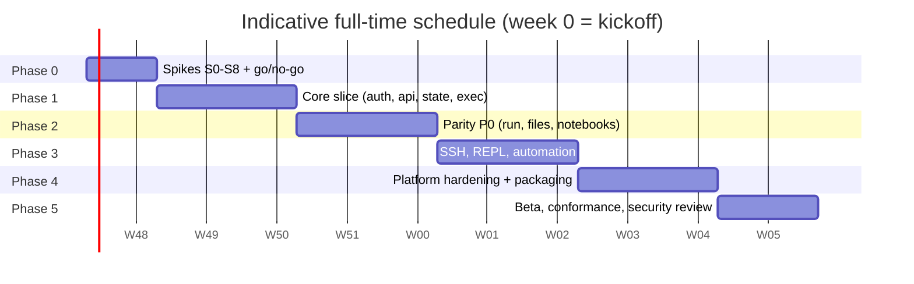
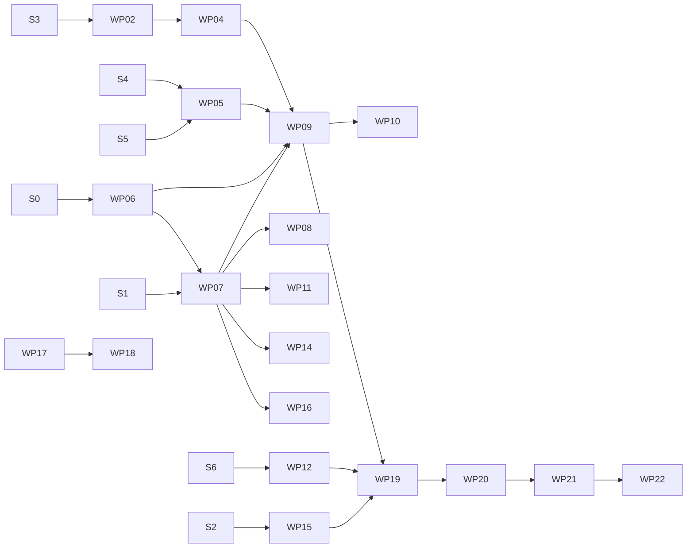

# 06 · Roadmap, Work Packages & Milestones

> **Estimate basis.** Order-of-magnitude (**±40 %**), for one experienced engineer working with an AI coding agent. Total ≈ **45–60 focused working days**.
> Full-time ≈ **9–12 weeks**. At ~15 h/week ≈ **5–6 months**. Re-baseline at **M0**.
> Sizes: **S** ≤ 1 day · **M** 2–3 days · **L** 4–6 days · **XL** > 1 week.

## 1. Strategy in one paragraph

De-risk first, parity second, polish last. The riskiest unknowns are *protocol details nobody has documented* (S0/S1) and *platform behaviour on Termux/Windows* (S2/S3). We prove those in a one-week spike phase with a hard go/no-go, then build a thin vertical slice (`new → exec → stop`), widen to full command parity, add SSH and REPL, harden per platform, and release. A permanent **upstream-sync** loop keeps us honest because the Python tool changes weekly.

(Dates are placeholders; only the relative lengths matter.)

---

## 2. Phase 0 · Spikes and go/no-go (≈ 1 week)

Each spike produces a **throw-away prototype + a written finding** appended to doc 02 or doc 04.

| ID | Question | Method | Pass criterion | Size |
|---|---|---|---|---|
| **S0** | What exactly does the wire look like? | run the **official Python CLI** through `mitmproxy` (`REQUESTS_CA_BUNDLE`/`SSL_CERT_FILE`), record C1–C8, kernel REST, WS handshake, contents, SSH upgrade; redact → `testdata/wire/` | all 8 items of doc 02 §7 answered; fixtures committed | M |
| **S1** | Can Go run code on a live runtime? | ~300 LOC: ADC token → assign → create kernel → WS → `print(1)` → capture outputs → stop. Test stale-kernel-id bug; test `kernel_info` handshake | prints `1`, VM released, re-attach keeps variables | L |
| **S2** | Is embedded SSH-over-WS viable? | `x/crypto/ssh` over `websocket.NetConn`; PTY, resize, `-- CMD` status; run on Linux **and Windows Terminal** | interactive shell + `exit 7` propagates | L |
| **S3** | Do the Termux fixes work? | real arm64 phone(s): resolver shim, CA shim, `x509roots/fallback`, `TMPDIR`, `faccessat2` on Android 10/12/14 | HTTPS works with no env vars set; no `SIGSYS` | M |
| **S4** | Token storage reality | `go-keyring` on Linux/macOS/Windows; locked/absent keyring timing; Windows blob limit; macOS `security` argv exposure; Python-entry import | no hang > 5 s; secrets not visible in `ps` | M |
| **S5** | OAuth in Go | remote copy-paste flow with the bundled client; PKCE; refresh; partial-consent scopes; ADC with user creds | token minted & refreshed; scopes persisted | M |
| **S6** | Chunked upload | `PUT` with `chunk:N`/`-1` against a live runtime; 1 GB file | works or documented fallback | S |
| **S7** | REPL library | prototype in 3 libs; test Windows Terminal, conhost, Termux, tmux, SSH, multi-line paste | pick one; record trade-offs | M |
| **S8** | Signed self-update | cosign verify in Go; Windows running-exe replace | updater passes on all 3 OS | M |

**Go/no-go (M0):** S0, S1 and S5 **must** pass. If S1 fails for protocol reasons we cannot replicate (e.g. client allow-listing, R-03), stop and re-scope (e.g. thin Go wrapper around the Python CLI, or contribute Windows/arm64 fixes upstream instead). S2/S3 may slip into Phase 3/4 with the risk logged.

---

## 3. Work packages

| WP | Package | Phase | Size | Depends | Acceptance (summary) |
|---|---|---|---|---|---|
| WP-01 | Repo bootstrap: module, lint (`golangci-lint`, `forbidigo`, `gosec`), CI skeleton, `AGENTS.md`, DEPENDENCIES.md | 1 | S | – | CI green on 6 runners |
| WP-02 | `platform`: paths, Termux detect, netfix, perms/ACL, tty, signals, browser | 1 | L | S3 | unit tests per OS |
| WP-03 | `logx`: slog, typed redaction, rotation | 1 | S | – | golden redaction test |
| WP-04 | `state`: stores, lock, atomic write, `.bak`, migration, name validation | 1 | M | WP-02 | crash-safety + concurrency tests |
| WP-05 | `auth`: ADC, OAuth remote flow, token store tiers, import of Python entry | 1 | L | S4,S5 | token never logged; fast fallback |
| WP-06 | `colabapi`: models, XSSI, XSRF, retry/reconcile, enums, `nbh` | 1 | M | S0 | fake-server tests from fixtures |
| WP-07 | `runtime`: REST lifecycle, WS framing, dispatcher, execute, idle timeout, outputs, stdin, `colab_request` | 1–2 | XL | S0,S1 | exec/stream/timeout/dead-kernel suite |
| WP-08 | `render`: stream/ANSI, display_data → text, Kitty images, `--output-image` | 2 | M | WP-07 | golden output tests |
| WP-09 | CLI P0: `new sessions status stop restart-kernel exec usage url version help` | 1–2 | L | WP-04..07 | parity table rows green |
| WP-10 | `run` (validation-first, args, exit semantics, teardown, signals) | 2 | L | WP-09 | upstream `run` tests ported |
| WP-11 | `nb` + notebook execution + `_output.ipynb` | 2 | M | WP-07 | round-trip tests |
| WP-12 | `contents` + `ls rm upload download edit` (chunked) | 2 | M | S6 | large-file test, 404 vs error semantics |
| WP-13 | `history` + `log` + exporters | 2–3 | M | WP-11 | 4 export formats golden |
| WP-14 | `install`, `auth`, `drivemount` (+ stdin∥stream) | 3 | M | WP-07 | fake `colab_request` flow tests |
| WP-15 | `sshx`: embedded client, key resolution, agent, host-key policy, PTY/resize, `--proxy-mode`, `--rm`, error mapping | 3 | XL | S2 | fake sshd + wire-contract tests |
| WP-16 | `repl` (piped = P0, TTY = P1) | 3 | L | S7 | piped EOF test; TTY manual matrix |
| WP-17 | `update`: version, check, signed self-update | 4 | M | S8 | verify-failure tests |
| WP-18 | Packaging: GoReleaser, nfpm, brew/scoop/winget, install scripts, completions | 4 | L | WP-17 | artefacts install & run on all tier-1 |
| WP-19 | Platform hardening: Windows console, Termux, macOS notarisation (opt.), WSL | 4 | L | WP-02,15 | doc 04 §9 per platform |
| WP-20 | Conformance suite vs Python + live-e2e nightly | 5 | L | all | zero unexplained diffs |
| WP-21 | Security review (doc 08 §3) + fuzzing | 5 | M | all | findings closed |
| WP-22 | Docs site, user guide (EN/AR), migration guide, SKILL.md for agents | 5 | M | all | reviewed |

---

## 4. Phases, exit criteria, deliverables

| Phase | Scope | Exit criteria | Release |
|---|---|---|---|
| **0** Spikes | S0–S8, repo skeleton | M0 go/no-go recorded in `docs/ADR/` | none |
| **1** Core slice | WP-01…07 (partial), `new → exec → stop` on Linux | live: create CPU runtime, `echo 'print(1)' \| colab exec`, stop; no tokens in logs | `v0.0.x` dev snapshots |
| **2** P0 parity | WP-08…13 | all **P0** rows of doc 05 green on Linux, macOS, Windows (fake server) + one live smoke each | `v0.2.0` (shipped) |
| **3** Parity-complete | WP-14…16 | all **P1** rows green; `ssh` interactive + `-- CMD` + proxy-mode verified on Linux/Windows; REPL decided | `v0.2.0-beta` |
| **4** Platforms & packaging | WP-17…19 | doc 04 §9 satisfied for all Tier-1; Termux nightly green; install channels live | `v0.3.0-rc` |
| **5** Hardening | WP-20…22 | conformance clean, security findings closed, docs complete | **`v1.0.0`** |

### v1.0 definition of done
1. All P0+P1 commands at parity or **documented Δ**.
2. Tier-1 platforms pass doc 04 §9.
3. Existing Python users switch **without re-login** and keep sessions/history.
4. No known data-loss, injection or traversal defect (doc 01 §10 closed).
5. Signed releases, SBOM, reproducible build check.
6. Two consecutive weekly live-e2e runs green; upstream-sync lag ≤ 2 weeks.

---

## 5. Upstream-sync policy (permanent)

The Python tool shipped a feature-removal and a new command within weeks. A port that is not actively tracked becomes wrong quickly.

1. **Watch:** GitHub "Releases/Tags" + `CHANGELOG.md` of `googlecolab/google-colab-cli` (weekly cron opens an issue with the diff).
2. **Triage** each upstream change into: *protocol* (live-capture and update fixtures), *CLI surface* (update doc 05 + tests), *docs-only*, *irrelevant*.
3. **Compat declaration:** `colab version` prints the upstream version it matches; `docs/COMPAT.md` lists known divergences.
4. **Contract tests:** golden wire fixtures re-captured from the *latest* Python release monthly; CI fails if the fake server and fixtures diverge.
5. **Breakage detection:** nightly **read-only** probe (`assignments`, `usage`) against live Colab using a throw-away account; a failure opens a priority issue (R-01).
6. **Contribute back:** Windows/arm64 fixes that are not Go-specific can be offered upstream (PR #70 shows interest).

## 6. Release & versioning
SemVer. `0.x` until v1.0 criteria. Tags `vX.Y.Z` drive GoReleaser. `CHANGELOG.md` in Keep-a-Changelog format (copying upstream's convention). Breaking change = CLI surface, flag semantics, **on-disk schema**, or persisted token format (same rule as upstream's `AGENTS.md`).

## 7. Team workflow (agent-friendly)
Adopt upstream's discipline, adapted for Go (see the repo's `AGENTS.md`): tests first, fake-server integration before live, **live e2e before declaring done**, update design docs with each behaviour change, never leave live runtimes allocated, never cut a release without explicit approval.
