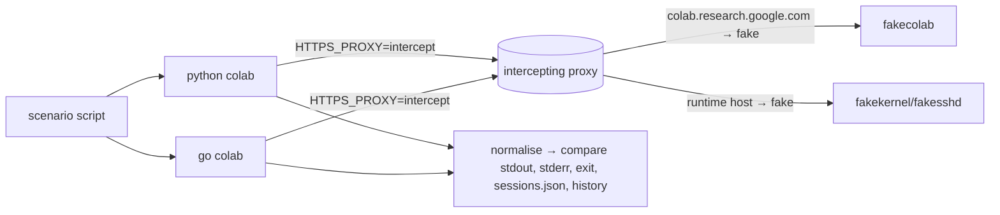

# 07 · Testing, Conformance & Live Capture

> Upstream's own rule, which we keep: **mocks are not enough; a feature is not done until it has passed against a live Colab runtime.** Upstream has 38 test files (~360 tests) and 7 live suites. We port the *intent* of every one and add layers the Python project lacks.

> **Implementation status — 2026-11-26 (v0.2.0).** **L1 Unit** and **L2
> Component** (fake Colab control plane + fake Jupyter kernel + fake sshd) are
> green and blocking in CI. **L3 Golden and L4 Differential are scaffolding
> only**: `scripts/golden.sh` and `scripts/differential.sh` exist, but there are
> zero scenario fixtures. `.github/workflows/live-e2e.yml` exists (kill switch,
> secrets gate, sweeper) and one billable CPU e2e pass is recorded in
> `CHANGELOG.md` `[0.2.0]` Verification — but no wire capture has been made and
> fakes are not live proof. The authoritative, up-to-date layer/porting/coverage matrix
> is [CONFORMANCE.md](CONFORMANCE.md); the tables below are the design target.
> The §11 coverage gates are **advisory** at v0.2.0:
> `scripts/coverage-gate.sh` floors at 70 % via `vars.COVERAGE_MIN`, and
> `scripts/goleak-check.sh` runs in ADVISORY mode. Human-only blockers are in
> [AUDIT-INDEX.md](AUDIT-INDEX.md) §5 and [CONFORMANCE.md](CONFORMANCE.md) §6.

## 1. Layers

| Layer | What | Runs | Gate |
|---|---|---|---|
| L1 Unit | pure functions, parsers, validators, state store | every PR, 6 OS runners, `-race` | blocking |
| L2 Component (fake servers) | CLI ↔ fake Colab control plane ↔ fake Jupyter kernel ↔ fake sshd, in-process | every PR | blocking |
| L3 Golden | stdout/stderr/exit/state files compared with fixtures | every PR | blocking |
| L4 Differential | same scenario against **Python CLI** and **Go CLI**, compare normalised results | nightly + release | blocking for release |
| L5 Live e2e | real Colab CPU runtime, throw-away account | nightly/manual, secrets-gated | blocking for release |
| L6 Platform | QEMU (armv7/riscv64/386), Termux emulator, real devices, Windows consoles | nightly / pre-release | blocking for Tier 1 |
| L7 Security & fuzz | redaction, traversal, injection, updater tamper, decoders | every PR (short) + nightly (long) | blocking |

## 2. Porting map: upstream tests → Go suites

| Upstream test files (count) | Intent | Go destination |
|---|---|---|
| `test_auth` (26), `test_auth_adc` (9), `test_local_credentials` (8) | OAuth flow, keyring, migration, ADC scopes | `internal/auth/*_test.go` (+ token-store matrix) |
| `test_client` (15), `test_consumption*` (4) | assign/unassign/list, XSSI, retries, 412 | `internal/colabapi` against `fakecolab` |
| `test_runtime` (10), `test_runtime_options` (5), `test_streaming` (12) | attach, idle timeout, streaming, dead kernel | `internal/runtime` against `fakekernel` |
| `test_contents` (6) | Contents API | `internal/contents` |
| `test_state` (19), `test_common` (6), `test_resolution_logic` (7), `test_history` (2) | stores, locking, resolve, history | `internal/state`, `internal/app`, `internal/history` |
| `test_cli` (35), `test_exec` (13), `test_ipynb_exec` (3), `test_run` (23), `test_repl` (15), `test_url` (12), `test_pay`, `test_version`, `test_whoami`, `test_readme`, `test_utils` (9), `test_cli_log`, `test_log_export` | command surface, messages, exit codes | `internal/cli` (golden-driven) |
| `test_automation` (6) | `install`, `auth`, `drivemount` | `internal/cli` + `runtime` hook tests |
| `test_ssh` (25), `test_ssh_autocreate` (9), `test_ssh_cmd` (9), `test_ssh_lifecycle` (11), `test_ssh_wire_contract` (8), `test_ssh_workdir` (3), `test_windows_ssh` (5) | SSH handshake, key rules, auto-create, `--rm`, wire contract, Windows quoting | `internal/sshx` against `fakesshd` + `fakecolab` |
| `test_update` (28) | version check, throttling, installer selection | `internal/update` (replace pip/uv logic with release/signature tests) |
| `mock_kernel.py`, `conftest.py` | fixtures | `internal/testutil` |

**Procedure:** for each Python test, write the Go test **first** (red), then implement. Record the upstream test name in a comment for traceability. Count the ported tests in `docs/CONFORMANCE.md`; target ≥ 360 equivalent cases by v0.2.

## 3. Fake servers (`internal/testutil`)

### 3.1 `fakecolab` (control plane)
`httptest.NewTLSServer` implementing C1–C8 with:
* correct **XSSI** prefix on a configurable subset of responses;
* GET-then-POST **XSRF** state machine (reject POST without the matching token);
* in-memory assignments keyed by `nbh`; idempotent re-GET returns shape B;
* **fault injection:** 412, 400-with-accelerator, 502/503/504, hung connection (ReadTimeout), slow body, token expiry in *N* seconds;
* request log for assertions (headers incl. `X-Colab-Client-Agent`, query `authuser=0`).

### 3.2 `fakekernel` (runtime proxy + Jupyter)
WebSocket server speaking the **default** protocol: kernel REST (`/api/kernels…`), contents API, scripted executions: `stream` (stdout/stderr), `display_data` (png/jpeg/html/markdown), `execute_result`, `update_display_data`, `clear_output`, `error`, `input_request`, `colab_request(dfs_ephemeral)`, `status dead/restarting`, delayed idle, **10 MB** messages, binary-buffer frames, silent hang (for idle-timeout tests). Port `tests/mock_kernel.py` first, then extend.

### 3.3 `fakesshd`
`x/crypto/ssh` server behind a WS↔TCP bridge. Accepts ed25519/ecdsa, **rejects RSA with HTTP 400 at upgrade**, records `pty-req`, `window-change`, `env`, `exec`, `shell`, and returns scripted exit statuses (0, 7, signal-killed ⇒ 255). Emits the 400/401/403/404/429/502 upgrade failures with the upstream JSON bodies.

## 4. Golden outputs
* Run every command through the **Python CLI against the fakes** (via §6) to produce `testdata/golden/<scenario>/{cmd,stdout,stderr,exit}` — the layout `scripts/golden.sh` consumes.
* **Normalise** before comparing: timestamps, UUIDs, session auto-names (6 hex), tokens, temp paths, line endings.
* Known intentional differences are to be recorded in `DELTAS.yaml` (mirrors doc 05 Δ-table); a golden run fails on an *unlisted* difference. The ledger does not exist yet — `testdata/golden/` currently holds only `README.md`.
* Generate/review fixtures with `COLAB_BIN=./golab bash scripts/golden.sh --scenario <name> --update` and a mandatory human review of the diff. `bash scripts/golden.sh --scenario wire` secret-scans wire fixtures. There is no `go test ./... -update` flag.

## 5. Live capture (Phase 0 / S0) — how, safely

Goal: ground-truth traffic from the **official** CLI.

1. Throw-away Google account; CPU runtime only; one session; unassign afterwards (`colab sessions` must be empty).
2. Preferred: **TLS key log**. `SSLKEYLOGFILE=/tmp/keys.log colab …` (CPython's `ssl` honours it), capture with Wireshark/`tshark`, decrypt with the key log. Works for REST **and** WebSocket **and** the SSH tunnel with no proxy settings.
3. Alternative: `mitmproxy`/`mitmdump` with `HTTPS_PROXY` + `REQUESTS_CA_BUNDLE`. REST goes through the proxy; whether the `websocket-client` library honours `HTTPS_PROXY` must be verified ❓ (else fall back to 2).
4. Cross-check with upstream's own debug log (`colab --logtostderr …`): requests/headers are logged (secrets masked).
5. **Redact before committing:** tokens, cookies, email, project ids, endpoint ids. Never commit raw captures. Store raw files outside the repo, delete after fixtures are derived.
6. Deliverables: `testdata/wire/*.json` (one file per endpoint, with request+response), `docs/02-protocol-spec.md` updated (🔴→🟢), list of minimal required headers.
7. Re-capture monthly (and on every upstream release touching `client.py`/`runtime.py`).

## 6. Differential testing (Python ↔ Go)

* The Python CLI hard-codes `Prod()`; we therefore redirect at the network layer: a small Go reverse proxy with a locally trusted CA (`SSL_CERT_FILE` / `REQUESTS_CA_BUNDLE`). The Go CLI needs **no** test hook for this path (ADR-013 keeps the build-tag hook for fast in-process tests only).
* Scenario list (≥ 40): each command happy path + each error row of doc 02 §6; `run` exit-code table; notebook execution; `--env` quoting; piped vs TTY; Unicode paths; Windows path inputs.
* A CI job fails on any unlisted diff.

## 7. Property-based & fuzz tests
| Target | Technique |
|---|---|
| WS frame decoder (JSON/binary-buffer) | `go test -fuzz`; invariants: never panics, never over-allocates, offsets validated |
| XSSI stripper, `nbh` encoder | table + fuzz (`len==44`, charset, idempotent strip) |
| Session-name validator | fuzz with `../`, NUL, Unicode, Windows reserved names |
| State store | N concurrent writer processes (helper binary) + `kill -9` mid-write: file always parseable, no lost sessions |
| POSIX quoting for `ssh -- argv` | round-trip through real `sh -c` |
| Output accumulator | random message sequences vs a reference model |
| Log redaction | generate secrets in URLs/JSON/headers/form bodies, assert none survive |

## 8. Security tests (map to doc 08 §3)
Redaction golden · path traversal · injection (`install`, `--env`, `run` args, remote paths) · file modes and Windows ACL · refusal of RSA keys · updater: wrong signature, wrong identity, downgrade, truncated download, tampered `update_url` · no secret in crash dumps · TLS: refuses invalid certs, no `InsecureSkipVerify` anywhere (`gosec` + `grep` gate) · `--config` path handling.

## 9. Live e2e (L5) — design and safety rules

**Scenarios** (ported from upstream `integration/`): `plot_redirection`, `run_command` (incl. `--keep`), `variable_persistence`, `bundled_oauth` (fast), `legacy_token_migration` (Python-entry import), `ssh` (fast + 95 s soak), `windows_ssh` (Windows runner). Add: large upload/download, notebook execution, `install`, high-RAM CPU, kernel restart, token refresh across expiry, stale-kernel recovery.
**Not automatable:** `auth`, `drivemount`, interactive `repl`/`ssh` ⇒ manual checklist per release.

**Safety rules (Colab VMs are billable and quota-limited):**
1. Dedicated throw-away account; CPU runtime only; **1 concurrent assignment**; global job concurrency = 1.
2. Every test registers cleanup (`defer Unassign`); a `finally`-style sweeper job lists assignments **older than 60 min** and unassigns them.
3. Prefer GET-only probes; log every endpoint created.
4. Kill switch: repo variable `LIVE_E2E_ENABLED=false` disables all live jobs.
5. Never run on fork PRs; secrets only on protected branches/manual dispatch.
6. Credentials: refresh token in an encrypted secret; rotate quarterly; scopes minimal.
7. Respect Colab's terms and fair-use; keep volume low (see R-04).

## 10. Platform tests (L6)
QEMU user-mode for `linux/arm`, `linux/riscv64`, `linux/386`, `linux/arm64`; Android emulator + Termux nightly; **manual** pre-release matrix:

| Terminal / OS | `ssh` | `repl` | resize | Ctrl-C | paste multi-line | images |
|---|---|---|---|---|---|---|
| Linux (GNOME Terminal, tmux) | ✔ | ✔ | ✔ | ✔ | ✔ | Kitty |
| macOS (Terminal, iTerm2, Ghostty) | ✔ | ✔ | ✔ | ✔ | ✔ | Kitty/iTerm |
| Windows Terminal, conhost, PS 5.1/7, Git-Bash | ✔ | ✔ | ✔ | ✔ | ✔ | n/a |
| Termux (Android 10/12/14), Termux:X11 not needed | ✔ | ✔ | ✔ | ✔ | ✔ | n/a |

## 11. Quality gates (CI)
`go vet` · `golangci-lint` (incl. `gosec`, `errorlint`, `forbidigo`, `noctx`, `bodyclose`) · `govulncheck` · `go mod verify` · `go test -race -count=1` · `goleak` · coverage ≥ **80 %** for `colabapi`, `runtime`, `state`, `sshx`, `auth` and **100 %** of the error-mapping table · reproducible-build check on release · `go-licenses` report.
